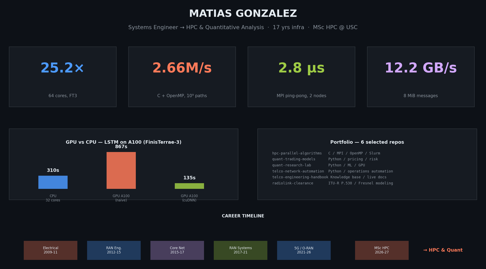



# Matías González

### Systems Engineer focused on High-Performance Computing and Quantitative Analysis

**17 years in mission-critical infrastructure** · **12 years at Telefónica (2G → 5G)** · **MSc HPC @ USC (BEME scholar)**

---

## What I Do

I design and optimize high-reliability systems and computational workloads.  
The benchmark figures shown here are measured on **CESGA FinisTerrae-3**.

## Work Model & Availability

- **EU citizen based in Galicia (Spain)**.
- **EU remote-only roles** (full-time or flexible models).
- Open to **asynchronous/flexible schedules** compatible with MSc HPC commitments.
- Occasional travel is possible when planned in advance.

## Evidence Model (Recruiter-Friendly)

- **E1 — Corporate Experience:** production roles in telecom operations/systems engineering.
- **E2 — Formal Education & Certifications:** accredited degrees, MSc HPC (in progress), and vendor/cloud certifications.
- **E3 — Public Portfolio Evidence:** GitHub repositories with reproducible code and documented outcomes.
- **E4 — Applied/Academic Learning:** in-progress or study-driven competencies, never presented as corporate production experience.

## Highlights

- **25.2× strong-scaling speedup** on 64 cores (FinisTerrae-3).
- **2.66M paths/s** throughput for Monte Carlo GBM workloads in C + OpenMP.
- **12.2 GB/s InfiniBand bandwidth** with **2.8 μs RTT** in MPI ping-pong tests.
- **LSTM runtime reduced to 135s** on A100 with cuDNN (vs 310s CPU baseline).

## Selected Repositories

| Repository | Focus | Stack |
|---|---|---|
| **[telco-network-automation](https://github.com/maezgonz/telco-network-automation)** | Network automation and fleet-level operational checks | Python |
| **[telco-engineering-handbook](https://github.com/maezgonz/telco-engineering-handbook)** | Telecom engineering reference and operations knowledge base | MkDocs · 3GPP · ITU-T |
| **[radiolink-clearance](https://github.com/maezgonz/radiolink-clearance)** | Microwave link planning using ITU-based propagation and Fresnel models | Python · Streamlit |
| **[hpc-parallel-algorithms](https://github.com/maezgonz/hpc-parallel-algorithms)** | **Applied/Academic Project** — parallel algorithms and numerical workloads on multi-core/HPC environments | C · MPI · OpenMP · Slurm |
| **[quant-research-lab](https://github.com/maezgonz/quant-research-lab)** | **Applied/Academic Project** — end-to-end quantitative research workflows with ML and GPU benchmarks | Python · TensorFlow · scikit-learn |
| **[quant-trading-models](https://github.com/maezgonz/quant-trading-models)** | **Applied/Academic Project** — pricing and risk tooling for quantitative finance | Python · NumPy · pandas |

## Core Stack

**Languages:** C, C++, Python  
**Parallel/HPC:** MPI, OpenMP, Slurm  
**Quant/ML:** NumPy, pandas, TensorFlow, scikit-learn  
**Infra/OS:** Linux

## GitHub Analytics

  
  

## Dashboard Update Workflow

1. Edit `metrics.json`.
2. Run:
   - `python -m pip install -r requirements.txt`
   - `python scripts/gen_dashboard.py`
3. Commit both `metrics.json` and `profile_dashboard.png`.
4. On PRs, **Validate dashboard inputs** checks schema/tests and verifies image freshness.
5. On merge to `main`, **Regenerate profile dashboard** updates the image when needed.

---

**Open to:** HPC engineering, quantitative research, and high-performance systems collaboration.
