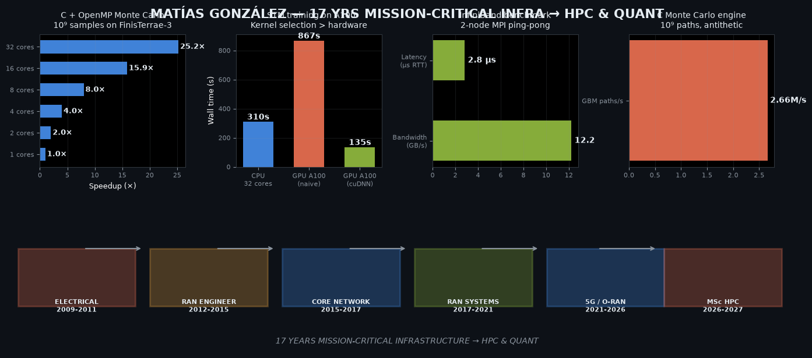



# Hi, I'm Matías González

### Systems Engineer → High-Performance Computing & Quantitative Analysis

**17 years mission-critical infrastructure** · **12 at Telefónica (2G→5G)** · **MSc HPC @ USC (BEME scholar)**

---

## 💡 What I Do (30-second version)

I spent **17 years** making sure millions of people could make phone calls — designing, operating and stress-testing mobile networks that had to work **99.9% of the time**. Now I'm pursuing an **MSc in High-Performance Computing** at USC, applying those same engineering principles to make **supercomputers and financial models run faster**.

The numbers in my dashboard aren't estimates — they're **measured on CESGA FinisTerrae-3**, the Galician supercomputer.

---

## 🎯 Key Repositories

| | Repo | What it does (plain English) | Tech |
|---|---|---|---|
| ⚡ | **[hpc-parallel-algorithms](https://github.com/maezgonz/hpc-parallel-algorithms)** | C code that runs on 64-core supercomputers — Monte Carlo simulations, solving physics problems across multiple machines | C · MPI · OpenMP · Slurm |
| 📈 | **[quant-trading-models](https://github.com/maezgonz/quant-trading-models)** | Python tools for pricing financial instruments and measuring portfolio risk | Python · NumPy · pandas |
| 🧪 | **[quant-research-lab](https://github.com/maezgonz/quant-research-lab)** | Full research lab: market data connectors (Argentine markets), portfolio optimizers, ML forecasting — recently benchmarked on GPU vs CPU | Python · TensorFlow · scikit-learn |
| 📡 | **[telco-network-automation](https://github.com/maezgonz/telco-network-automation)** | Tools that automate network operations — checking if devices are reachable and detecting configuration drift | Python · concurrent |
| 📚 | **[telco-engineering-handbook](https://github.com/maezgonz/telco-engineering-handbook)** | 12 years of telecom knowledge distilled into 7 public reference documents — KPIs, alarm correlation, stress testing — published as a [live website](https://maezgonz.github.io/telco-engineering-handbook/) | MkDocs · 3GPP · ITU-T |
| 📐 | **[radiolink-clearance](https://github.com/maezgonz/radiolink-clearance)** | Engineering tool for microwave link design — calculates Fresnel zones and optimizes antenna tower heights per ITU standards | Python · Streamlit |
| 📊 | **[bi-sap-supply-chain](https://github.com/maezgonz/bi-sap-supply-chain)** | Business Intelligence dashboard design — star schema, DAX KPIs, executive storytelling for SAP procurement data | Power BI · DAX |
| 📄 | **[cv](https://github.com/maezgonz/cv)** | My CV — auto-rendered to PDF on every commit | Quarto · CI |

---

## 🛠 Core Stack

  
  
  
  
  
  
  
  
  

---

## 📫 GitHub Analytics

  
  

---

Last edited on: 15/10/2026
